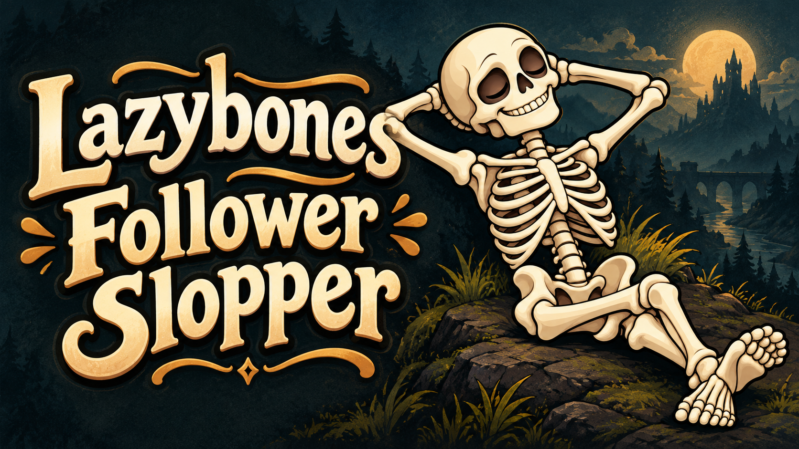

# Lazybones Follower Slopper



Windows x64 application that creates a follower install ZIP from a Skyrim save
and matching finished RaceMenu head export. Review follower settings, race,
equipment and individual asset packaging choices in the GUI. Select BodySlide
build, OBody NG (as-is), or both applicable outputs; both produce a FOMOD installer.

## Install and use

Download the [Windows x64 application packet](https://github.com/mhkul/Lazybones-Follower-Slopper/releases/download/v0.1.6/Lazybones-Follower-Slopper-0.1.6-windows-x64.zip)
from [release v0.1.6](https://github.com/mhkul/Lazybones-Follower-Slopper/releases/tag/v0.1.6). Extract outside game, mod and input folders. Run the EXE
directly for physical/deployed Data, or register it in MO2 with empty Arguments
and run through the intended existing profile. End-user Python and .NET are bundled.
This source repository does not contain the EXE or dependency binaries.

Choose the save and head NIF, then Continue. Resolve matching co-save, tint DDS
and JSlot when requested. Review settings and dependencies, choose outputs and
the Save ZIP to destination, then Build. Install the resulting follower ZIP
through your mod manager and follow its dependency instructions.
Mesh-bearing ammunition is included alongside armor and weapons. Output controls
are BodySlide build and OBody NG (as-is); unassigned characters use As-is
(no BodySlide). Missing compatible outfit projects retain captured meshes with
warnings about unavailable preset baking. The error window offers an anonymous
diagnostic ZIP by default, with
private files available only through an unchecked opt-in. Owned scratch cleanup
preserves unconfirmed packages and delivery retries.
See the [installation, operation and rebuild guide](src/AGENT_GUIDE.md).

Having trouble? See [how to report a problem](docs/REPORTING_ISSUES.md).

## Build from source

The complete build layout is under `src/`: C# GUI/Foundation/Writer, Python
Stages, packagers, pinned dependency metadata and branding resources.
See [BUILD.txt](src/BUILD.txt) for the archive hash and full requirements:
Windows x64, PowerShell, .NET SDK 8.0.422, developer Python 3.12+, NuGet access
or a populated developer cache, and the official Python 3.13.9 amd64 embeddable ZIP.

From repository `src/`, adapt these paths and choose a fresh output folder:

```powershell
./Gui/Build-Gui.ps1 -Python 'D:/Tools/Python/python.exe' -RuntimeArchive 'D:/Downloads/python-3.13.9-embed-amd64.zip' -Output 'D:/FreshBuild/LazybonesApplication'
```

`-Offline` requires the pinned NuGet packages and Windows x64/.NET 8.0.28 runtime
packs already cached. Build inputs require no game files or historical project
artifacts. The source guide and README.txt retain application-packet layout
descriptions; in this repository they live inside `src/`. Build output includes
private intermediates; distribute the application with its notices and source.
There is no public release-packaging or unattended follower-generation command.

## Current limits

User manual testing passed on Skyrim SE 1.5.97/MO2. AE, VR, other stores/managers
and actual Vortex setups remain unverified. The application is unsigned; versions
are informational and source/format checks still apply. Body overlays are
deferred with warnings. Recoverable missing references may retain items with
named warnings; appearance, audio or behavior can differ. When useful follower
files can be written safely, failed output checks complete as **Built with
warnings**. Unresolved references remain intact and failed checks stay failed.
An unavailable preset bake can use captured installed meshes; a surviving
requested variant can still be delivered. The follower ZIP names these limits
and may require repair before it loads or works. Read Build details.

Non-OBody meshes remain as-is. Prebuilt XML/BodySlide work applies only to
OBody-preset-affected meshes; OBody uses captured winning installed meshes and
compatible morph files. Runtime SMP, retained assets/races and compatibility
rules require the dependencies named in the follower ZIP. The builder installs
no runtime facilities and edits no global OBody assignments.

## Licensing and redistribution

Application code is GPL-3.0-only, without warranty: [LICENSE](LICENSE).
The complete [license and notice appendix](src/LICENSES.txt) preserves application,
third-party and asset-responsibility notices and full license texts. Historical
notice filenames within that appendix identify its labeled sections, rather
than missing loose files. Bundled components and assets retain their own terms.
Creating a follower grants no right to redistribute its source assets.

When redistributing application binaries, supply matching application source
and access to `Lazybones-Follower-Slopper-0.1.6-thirdparty-source.zip`, the separate
dependency-source release asset containing full notices and exact binary/revision
correspondence indexes. This repository does not replace that companion.
Published upstream binaries were not independently rebuilt. Download matching
[application source at v0.1.6](https://github.com/mhkul/Lazybones-Follower-Slopper/tree/v0.1.6/src) or its [tagged repository ZIP](https://github.com/mhkul/Lazybones-Follower-Slopper/archive/refs/tags/v0.1.6.zip),
[dependency source](https://github.com/mhkul/Lazybones-Follower-Slopper/releases/download/v0.1.6/Lazybones-Follower-Slopper-0.1.6-thirdparty-source.zip)
and [checksums in the release notes](https://github.com/mhkul/Lazybones-Follower-Slopper/releases/tag/v0.1.6)
from the same release. The Windows ZIP already includes buildable `src/`;
the dependency-source ZIP is for rebuilding or redistribution and is not needed to run the app.

For binary redistribution, preserve the [Python native component metadata](src/dependencies/python-native-components.json).
The v0.1.6 dependency-source
companion includes the matching ctypes/libffi source, full notices and updated
component indexes alongside the existing dependency sources.

Builds finish with warnings when usable output can be written safely, including
partial requested outputs or unresolved quality findings. Review Build details
and the generated install instructions: warnings may mean appearance or gameplay
defects, unavailable preset baking or assignment, or a plugin that cannot load.
Failed checks remain failed; warnings do not establish in-game success.

Existing-race builds keep the installed actor skeleton while preserving legitimate
skin, equipment and SMP mesh references. Custom races preserve captured skin tint
inputs. After a BodySlide failure, a fresh mesh pair is used only when independent
preset geometry checks pass; otherwise captured meshes remain a warned fallback.
Reporter-specific colour differences and native crash causes remain unconfirmed.

Partial-opacity skin tint and automatic saved reference scale are preserved.
Standalone equipment can preserve verified injected keyword identities; unresolved
keyword assignments offer keep, selected removal, or cancellation. Selections apply
consistently across Prebuilt and OBody outputs. BodySlide presets support both,
small and big endpoints with native document-order precedence.

MO2 startup supports default instance paths and profile-local or Documents INIs.
When automatic discovery needs help, select a validated instance configuration.
Quoted, escaped and inline-comment settings are handled consistently, and
discovery errors explain the available recovery actions.
